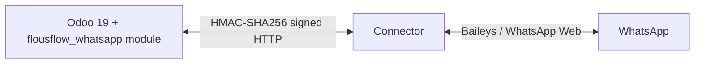

# Flous Flow WhatsApp Connector

The companion gateway for the **Flous Flow WhatsApp** Odoo module. It is the
piece that actually talks to WhatsApp:

- **Pairs numbers via QR** using a persistent Baileys session
- **Bridges messages** between WhatsApp and the Odoo module's signed HTTP API
- **Avoids bans** by rate-limiting outbound, respecting the 24-hour
  customer-service window, and **automatically updating the WhatsApp client
  library** so it never lags behind WhatsApp's protocol changes
- Ships with a **unified Docker Compose** that brings up Odoo 19 + the module +
  this connector with a single `docker compose up`

> This connector is a **separate Node.js service**. The Odoo module on
> Odoo Apps is pure Python and does **not** bundle it — you run this service
> next to Odoo (Docker or bare Node).

---

## Architecture



The Odoo module is the "brains" (inbox, routing, SLA, CRM/Sales/Accounting
bridges). This connector is the "hands" — it owns the WhatsApp connection and
calls the module's signed API:

| Module endpoint | Connector uses it to |
|---|---|
| `POST /sessions/<key>/status` | report `qr` / `connecting` / `connected` / `reconnect` / `error` |
| `POST /events` | push inbound messages and outbound echoes |
| `POST /outbox/claim` | pull outbound messages to send |
| `POST /outbox/<id>/ack` | ack `sent` / `delivered` / `read` / `failed` |
| `POST /outbox/receipt` | report delivery/read receipts |
| `POST /attachments/<id>` | download attachment bytes for outbound media |

---

## Quick start (unified stack)

```bash
git clone https://github.com/FlousFlow/flousflow_whatsapp_connector.git
cd flousflow_whatsapp_connector

# Put the Odoo module where the compose expects it (one command):
git clone https://github.com/FlousFlow/flousflow_whatsapp.git odoo_addons/flousflow_whatsapp

cp .env.example .env
# edit .env: set FLOUSFLOW_WHATSAPP_CONNECTOR_SECRET and WHATSAPP_SESSIONS

docker compose up -d --build
```

1. Open `http://localhost:8069` and install the **Flous Flow WhatsApp** module.
2. Create a WhatsApp **Number** and set its **Connector Session Key** to one of
   the keys in `WHATSAPP_SESSIONS`.
3. Open the number form → **Connector** tab → scan the QR with WhatsApp.
4. When the state flips to **Connected**, the inbox is live.

> Both the Odoo server and the connector must share the same
> `FLOUSFLOW_WHATSAPP_CONNECTOR_SECRET`.

---

## Configuration

All settings are environment variables (see `.env.example`):

| Variable | Default | Purpose |
|---|---|---|
| `ODOO_BASE_URL` | `http://localhost:8069` | Odoo server URL (`http://web:8069` in Docker) |
| `FLOUSFLOW_WHATSAPP_CONNECTOR_SECRET` | — | shared HMAC secret (must match Odoo) |
| `WHATSAPP_SESSIONS` | — | comma-separated connector session keys |
| `MIN_SEND_DELAY_MS` / `MAX_SEND_DELAY_MS` | 1500 / 4000 | random delay between outbound sends |
| `MAX_SENDS_PER_MINUTE` | 15 | hard cap on outbound rate |
| `CUSTOMER_WINDOW_HOURS` | 24 | stop messaging customers who wrote longer ago (0 = off) |
| `AUTO_UPDATE_ENABLED` | true | auto-update Baileys on a schedule |
| `AUTO_UPDATE_INTERVAL_MS` | 6h | how often to check for library updates |
| `OUTBOX_POLL_SECONDS` | 2 | outbox polling interval |
| `QR_REPORT_EVERY_MS` | 10s | how often a fresh QR is pushed to Odoo |

---

## Automatic library updates (ban avoidance)

WhatsApp regularly changes its protocol. An outdated client library is the most
common cause of bans and disconnections, so the connector keeps Baileys current
by default:

- A scheduler runs `scripts/update-libs.sh` every `AUTO_UPDATE_INTERVAL_MS`.
- The script runs `npm install @whiskeysockets/baileys@latest`, applies
  low-risk `npm audit fix`, logs to `data/lib-updates.log` and restarts the
  service so the new library is loaded (`kill -TERM 1`; the container has
  `restart: unless-stopped` so Docker starts it again automatically).

Run it manually:

```bash
docker compose exec connector bash scripts/update-libs.sh
```

---

## Run without Docker (bare Node)

```bash
npm install
cp .env.example .env   # edit values
npm start
```

---

## Ban-avoidance checklist (included by default)

- [x] Randomised delay between outbound messages (`MIN/MAX_SEND_DELAY_MS`)
- [x] Hard per-minute cap (`MAX_SENDS_PER_MINUTE`)
- [x] 24-hour customer-service window enforcement (`CUSTOMER_WINDOW_HOURS`)
- [x] One persistent session per number (no repeated logins)
- [x] Graceful reconnect reporting (`reconnect` / `error` to Odoo)
- [x] **Automatic WhatsApp client library updates** (`AUTO_UPDATE_ENABLED`)
- [ ] New-number warm-up: enable only after a few days of normal use

---

## Security

- Every request to Odoo is HMAC-SHA256 signed with a timestamp window and a
  one-time nonce — exactly what the Odoo module verifies.
- Credentials/session state are stored under `CONNECTOR_DATA_DIR/sessions`.
- The connector never exposes its own public API; it only talks outbound to
  Odoo.

## License

LGPL-3.0 — see `LICENSE`.
